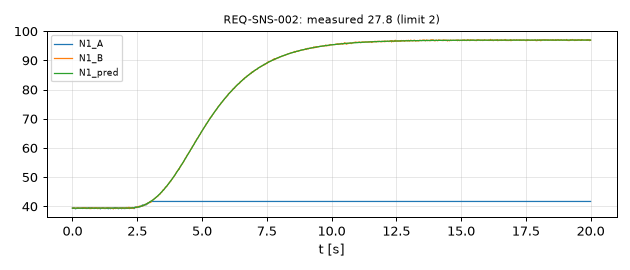
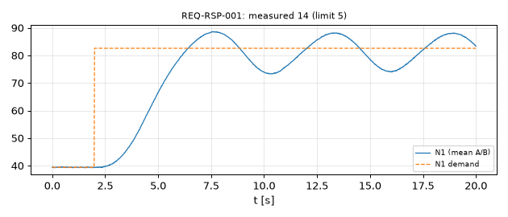

# TestBedLens

A small Python tool for checking turbofan test-bed style logs against requirement-style
criteria, written as a personal learning project on engine test data analysis.

It has two parts:

1. `testbedlens/model.py`: a simplified two-spool turbofan transient model (first-order
   N1/N2/EGT lags, PI fuel controller on N1 with fuel-flow min/max and rate limits,
   anti-windup) that writes synthetic CSV logs for seven scenarios: throttle step up,
   throttle step down, a start sequence, N1 sensor drift, N1 sensor stuck, an N1 noise
   burst, and a deliberately mistuned controller gain. N1 is logged on two channels
   (`N1_A`, `N1_B`); faults are injected on channel A.
2. `testbedlens/analyze.py`: reads a log, evaluates each requirement in a JSON spec
   (`specs/step.json`, `specs/start.json`) and writes a Markdown report with one plot per
   requirement ID. Checks: limit exceedance, overshoot, 10-90 % rise time, settling time,
   rate limit, duplex channel agreement, and residual against a model prediction.

The diagnosis step separates a sensor problem from a control-response problem. The
logged fuel flow is replayed through the plant model to predict N1. If one channel leaves
the prediction while the other follows it, the run is flagged as a suspected sensor fault
on that channel. If both channels follow the prediction but response checks fail, the
problem is in the control response (for example the mistuned gain scenario).

## Run

```
pip install -r requirements.txt
python -m testbedlens out     # writes out/logs/*.csv and out/reports/<scenario>/report.md
python -m pytest -q
```

Expected demo output:

```
accel_step     PASS
decel_step     PASS
start          PASS
fault_drift    FAIL REQ-SNS-001,REQ-SNS-002
fault_stuck    FAIL REQ-LIM-002,REQ-RSP-002,REQ-RSP-003,REQ-SNS-001,REQ-SNS-002
fault_noise    FAIL REQ-RSP-001,REQ-RSP-003,REQ-SNS-001,REQ-SNS-002
mistuned_gain  FAIL REQ-RSP-001,REQ-RSP-003
```

The stuck-sensor run shows why the diagnosis matters: the controller averages a frozen
channel A with a healthy channel B, drives the engine too high and fails an N2 limit, but
the report attributes the failures to the sensor rather than to the control law.

## Sample plots

Stuck N1 channel A versus channel B and the model prediction:



Mistuned gain: overshoot with both channels healthy:



## Limits and honesty

- All data is synthetic, generated by a simplified first-order model with invented
  parameters. It is not FADEC data, not real engine data and not validated against any
  engine.
- The controller is a textbook PI loop, not a FADEC control law. The analysis checks and
  limits are illustrative, not taken from any engine specification.
- Not certified, not intended for any real test or airworthiness use.
- Personal project. Not affiliated with or endorsed by Rolls-Royce or any engine maker.
